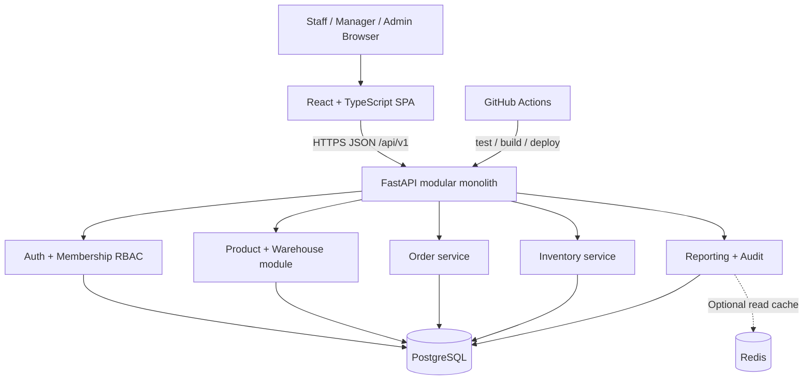
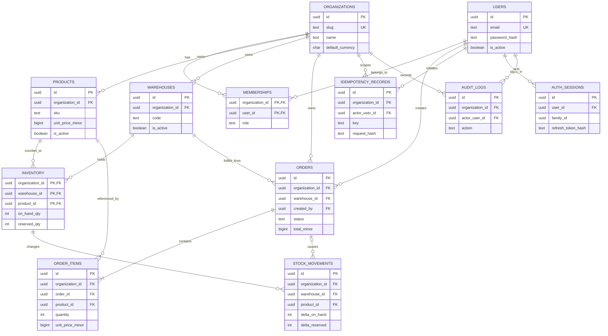
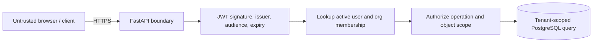
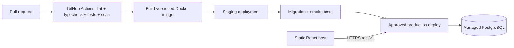

# StockPilot — Technical Design Specification

**Version:** 1.0 (design baseline)  
**Date:** 12 November 2026  
**Status:** Approved-for-implementation proposal; implementation and production validation not yet performed  
**Application:** Multi-tenant Order & Inventory Management SaaS  
**Target stack:** React + TypeScript + Tailwind CSS; Python + FastAPI + Pydantic; SQLAlchemy 2.x + Alembic; PostgreSQL 16+; Redis (post-MVP); Pytest + HTTPX; Docker; GitHub Actions.

> **Artifacts in this package:** `TECHNICAL_DESIGN.md` (this document), `schema.sql` (complete PostgreSQL baseline), `openapi.yaml` (machine-readable OpenAPI 3.1 contract), `erd.svg` and `erd.png` (rendered diagrams), and `README.md`. The SQL DDL is also reproduced in Appendix A for a self-contained specification.

## 1. Executive summary and key design decisions

StockPilot lets separate businesses operate private workspaces where authorized staff manage product catalogs, warehouses, physical stock, orders, reservations, fulfillment, and audit histories. It is an **internal B2B operations system**, not a public e-commerce checkout or payment platform.

**Design commitments:**

1. **Modular monolith:** one FastAPI deployment with module boundaries for auth, organizations, products, warehouses, inventory, orders, reporting and audit. No microservices for v1.
2. **Tenant isolation:** all business records carry `organization_id`; server-side membership authorization is mandatory on every tenant endpoint; composite foreign keys prevent cross-tenant references.
3. **PostgreSQL source of truth:** Redis is never used for authoritative stock changes or locking.
4. **Inventory invariant:** `available_qty = on_hand_qty - reserved_qty`; `0 <= reserved_qty <= on_hand_qty`. `available_qty` is calculated, not stored.
5. **Orders reserve first:** successful order creation immediately reserves all items in a **single database transaction**. Fulfillment consumes on-hand units; cancellation releases reservations.
6. **Concurrency-safe updates:** conditional atomic SQL updates plus row locks; deterministic product lock order; idempotency keys on order creation.
7. **Secure browser sessions:** short-lived bearer JWTs and rotating, opaque refresh tokens in `HttpOnly` cookies with CSRF protection.
8. **Measure actual results:** performance claims and resume metrics must come from automated tests and benchmarks, not estimates.

## 2. Product scope and assumptions

| Topic | Decision for MVP |
|---|---|
| Target users | Admin, manager, staff, viewer inside registered organizations |
| Tenant membership | A user may belong to multiple organizations with different roles |
| Warehouse | An order is fulfilled entirely from **one warehouse** |
| Catalog | Each organization owns its products; `(organization_id, sku)` is unique |
| Units | Whole non-negative units only; serialized, fractional and batch stock are out of scope |
| Currency | One organization-level ISO 4217 currency (default INR); fixed after first order |
| Money | Store non-negative integer minor currency units; no floats |
| Pricing | Snapshot unit prices and currency into order items/order at creation |
| Tax and payment | Not included; `total_minor = sum(quantity * unit_price_minor)` |
| Customer | Customer name and optional email are fields of an order; customers are not platform accounts |
| Reservation expiry | No automatic expiry in MVP; reservations persist until fulfilled or cancelled |
| Deletion | Soft-deactivate products/warehouses; retain orders, movements and audit events |
| Integrations | No external commerce, shipping, payment gateway or email integration in MVP |
| Deployment | One API service, one SPA hosting target, managed PostgreSQL; optional Redis |

**Explicit non-goals (v1):** public checkout, payments, returns/refunds, shipping label creation, warehouse transfers, purchase orders, batch/serial number tracking, tax computation, SMS/email notifications, multi-currency conversion, multi-warehouse order allocation, offline synchronization, and microservices.

## 3. Functional requirements

| ID | Priority | Requirement | Acceptance criterion |
|---|---|---|---|
| FR-01 | P0 | Register, log in, refresh, log out | Valid credentials produce access token; revocation blocks refresh |
| FR-02 | P0 | Create organization and initial admin | Workspace and creator's admin membership commit atomically |
| FR-03 | P0 | Roles and tenant isolation | Unauthorized actor gets 403; foreign-tenant resource gets 404 |
| FR-04 | P0 | Manage catalog | SKU unique within organization; inactive products cannot be ordered |
| FR-05 | P0 | Manage warehouses | Warehouse code unique within organization; inactive warehouses block new orders |
| FR-06 | P0 | Receive/adjust stock | No update can make `on_hand_qty < reserved_qty` |
| FR-07 | P0 | Create multi-line orders | All lines reserve atomically; any unavailable line aborts entire order |
| FR-08 | P0 | Idempotent order creation | Same key and body replay original 201; changed body yields 409 |
| FR-09 | P0 | Fulfill order | `reserved -> fulfilled`; both on-hand and reserved reduced |
| FR-10 | P0 | Cancel reserved order | `reserved -> cancelled`; reserved reduced without changing on-hand |
| FR-11 | P0 | Search, filter, paginate | Tenant-scoped lists, max 100 records/page; deterministic cursor pagination |
| FR-12 | P0 | Auditable stock movements | Each stock change produces movement in same transaction |
| FR-13 | P1 | Business dashboard | Orders by status, low-stock positions and inventory value |
| FR-14 | P1 | Team administration | Admin adds registered users and changes roles, preserving one admin |
| FR-15 | P1 | Audit logs | Important mutations record actor, tenant, entity, action and time |
| FR-16 | P1 | Automated verification | Tests cover permission failures, transaction rollback and concurrency |
| FR-17 | P2 | Redis caching | Cache read-only dashboards; invalidate after relevant changes |
| FR-18 | P2 | Operational polish | Structured logs, metrics, health endpoints, backups, CI/CD |

**Role permissions:**

| Operation | Admin | Manager | Staff | Viewer |
|---|:---:|:---:|:---:|:---:|
| View products, warehouses, inventory, dashboards | ✓ | ✓ | ✓ | ✓ |
| View orders | ✓ | ✓ | ✓ | ✓* |
| Add/change members or roles | ✓ | — | — | — |
| List member roster | ✓ | ✓ | — | — |
| Create/update/deactivate product or warehouse | ✓ | ✓ | — | — |
| Receive/adjust physical stock | ✓ | ✓ | — | — |
| Create/reserve order | ✓ | ✓ | ✓ | — |
| Fulfill an order | ✓ | ✓ | — | — |
| Cancel reserved order | ✓ | ✓ | Own-created orders | — |
| View audit logs and stock movements | ✓ | ✓ | — | — |

`*` Viewers receive customer email as `null` (redacted); managers/admins/staff may view it as needed for fulfillment. Only admins may edit membership. Authorization is **based on membership looked up from PostgreSQL**, not a role accepted from client input or trusted from stale JWT claims.

### Primary workflows

**A. Organization setup:** user registers -> logs in -> creates organization -> receives admin membership -> adds existing registered staff -> creates warehouse -> creates products -> receipts stock.

**B. Order lifecycle:** authorized staff chooses warehouse and products -> creates order with idempotency key -> server snapshots price and reserves all lines -> manager fulfills, or authorized user cancels -> stock ledger and audit trail updated.

**C. Reporting:** dashboards aggregate orders and current inventory. Redis may cache these results later but never supplies the truth for order acceptance.

## 4. Non-functional requirements and proposed engineering budgets

These are **targets for development/testing**, not measured performance claims.

| Dimension | Baseline requirement / target |
|---|---|
| Security | No cross-tenant reads/writes; tested at API and SQL query layer |
| Consistency | Strong transactional consistency for stock and order state; no overselling |
| Reliability | Roll back full order if any line fails; no partial reservations |
| Performance | Staging p95 read <= 300 ms and order-create p95 <= 500 ms under an initial 30-concurrent-user workload; revisit after measurement |
| Scale | Test with >= 10,000 products and >= 100,000 orders distributed across tenants |
| Data | Retain orders/audit records per documented retention; backups encrypted |
| Availability | One API instance for MVP; production availability SLO deferred until hosting is chosen |
| Accessibility | Keyboard-navigable forms, labels, validation messages, WCAG-oriented UI |
| Maintainability | Typed request/response schemas, migrations, small services, tests and documented decisions |
| Operations | Request IDs, structured logs, DB readiness check, error monitoring |
| Pagination | Limit 1–100; keyset cursor with `(created_at, id)` or stable tuple per resource |

### Success criteria for the first deployable release

A deployed user can log in, create an organization, create products/warehouses, receive stock, place a multi-line order, fulfill/cancel it and inspect the movement history. Automated tests demonstrate tenant isolation and no overselling with concurrent requests. CI checks pass on a fresh clone. There are no secrets in Git history.

## 5. High-level software architecture



**Frontend:** React Router, TypeScript API client, reusable form components, auth context, role-aware navigation (UI hiding is convenience only; backend rechecks every permission), product/inventory tables, order form, dashboard, audit screen. Use a query-state library if convenient; never mutate stock client-side as authoritative state.

**Backend modules:**

- `api/` route handlers and dependency injection: parse input, inject current user/membership, serialize output.
- `core/` configuration, JWT validation, logging, standardized errors, rate limiting, request IDs.
- `models/` SQLAlchemy 2.x database models, with composite tenant foreign keys.
- `schemas/` Pydantic models for input/output.
- `repositories/` explicitly tenant-scoped persistence queries.
- `services/` business rules and transaction orchestration; **one transaction coordinator per use case**.
- `db/` engine/session construction, migration configuration.
- `tests/` unit, integration, security and concurrency test suites.

**Database sessions:** create a fresh SQLAlchemy session per request; perform mutation in `with session.begin():`; commit once after all related changes; rollback automatically on error; never keep DB transactions open during network calls. Prefer explicit SQL for guarded stock updates.

## 6. Entity relationship diagram

The figure is also available as `erd.svg` and `erd.png` in this package.



**Important physical model distinctions:** inventory is identified by the compound key `(organization_id, warehouse_id, product_id)`; `stock_movements` references that inventory position using a composite tenant-safe foreign key. `memberships` joins users and organizations. All tenant-specific resource references use composite foreign keys `(organization_id, id)` wherever the referenced record is tenant-owned.

## 7. Detailed data dictionary and invariants

| Table | Grain | Important constraints |
|---|---|---|
| `users` | One platform account | Unique case-insensitive email, hashed password, active flag |
| `organizations` | One business | Globally unique lowercase slug, default currency |
| `memberships` | User in organization | Composite PK `(organization_id,user_id)`, one of four roles |
| `products` | One SKU in organization | Unique `(organization_id,sku)`, price in minor units, soft active flag |
| `warehouses` | One location in organization | Unique `(organization_id,code)`, soft active flag |
| `inventory` | Product at warehouse | Composite PK; `on_hand >= reserved >= 0` |
| `orders` | One order | `reserved/fulfilled/cancelled` state; price total and currency snapshot |
| `order_items` | Product line within order | Positive quantity, unique product per order, immutable price snapshot |
| `stock_movements` | One stock delta event | Signed `delta_on_hand` and `delta_reserved`; append-only by service policy |
| `idempotency_records` | Actor+route+key | Unique key scope; request hash; complete stored response for 7 days |
| `auth_sessions` | One refresh token generation | Opaque token hash only, rotation family, revoke/reuse detection |
| `audit_logs` | One authorized mutation | Tenant, actor, entity, action, time; redact sensitive payloads |

**No direct quantity assignments:** except initial zero rows, inventory changes only through adjustment, reservation, fulfillment and release services.

**Inventory algebra:**

- Stock receipt +5: `on_hand += 5; reserved += 0`.
- Order reserves 2: `on_hand += 0; reserved += 2`.
- Fulfillment of 2: `on_hand -= 2; reserved -= 2`.
- Cancellation of 2: `on_hand += 0; reserved -= 2`.
- Negative physical correction -1: permitted only if `on_hand - 1 >= reserved`.
- Always display **available = on_hand - reserved**, and never compute it using cached values for an order write.

**Example:** receipt 10 -> `(on_hand=10,reserved=0,available=10)`; reserve 3 -> `(10,3,7)`; fulfill 3 -> `(7,0,7)`.

**Price and identity:** order items record their unit price at creation; future product edits do not alter orders. Product and warehouse deletions are not exposed. `organization.default_currency` becomes immutable as soon as an order exists. All IDs are UUIDs; `order_number` is a human-readable `SO-` followed by the generated order UUID without dashes (unique per tenant).

**Historical audit:** removing a user from an organization does not delete their order/audit history. Retention and privacy deletion procedures require a later policy and legal review.

### Index strategy

`schema.sql` includes the relevant tenant-leading indexes. Most queries begin with `WHERE organization_id = :org_id`; order list uses `(organization_id, created_at DESC, id DESC)`; status views use `(organization_id, status, created_at DESC)`; lookups use composite keys and uniqueness indexes. Validate index effectiveness with `EXPLAIN (ANALYZE, BUFFERS)` against seeded data before adding extra indexes.

## 8. Order state machine and business rules

```mermaid
stateDiagram-v2
    [*] --> reserved : POST /orders; reserve all items
    reserved --> fulfilled : POST /fulfill; consume stock
    reserved --> cancelled : POST /cancel; release reservation
    fulfilled --> [*]
    cancelled --> [*]
```



**Last-admin concurrency rule:** for any role change that might remove an admin, lock the `organizations` row with `SELECT ... FOR UPDATE`, count remaining active admin memberships, and reject the operation with `409 LAST_ADMIN_REQUIRED` if it would leave zero admins. Serialize all admin demotions for that organization through the same lock.

- `reserved -> fulfilled` only; after fulfillment, do not permit cancellation through MVP API.
- `reserved -> cancelled` only; an already cancelled order can be returned unchanged on repeat cancel, without stock adjustment.
- Repeating `fulfill` on fulfilled order returns unchanged `200`, and repeating `cancel` on cancelled order returns unchanged `200`. Calling the opposite transition after terminal state returns `409 ORDER_STATE_CONFLICT`.
- Drafts, partial fulfillment, returns and exchanges are excluded.
- Deactivating a warehouse/product blocks new orders but does not block completion of existing reservations.

## 9. Transactional concurrency design

### 9.1 The race being prevented

For inventory `(on_hand=1,reserved=0)` and two simultaneous requests each ordering one unit, **exactly one** should commit, leaving `(on_hand=1,reserved=1,available=0)`; the other receives `409 INSUFFICIENT_STOCK`. No order row or ledger event is committed for the failed request.

### 9.2 Atomic reservation SQL

```sql
UPDATE inventory
SET reserved_qty = reserved_qty + :quantity
WHERE organization_id = :org_id
  AND warehouse_id = :warehouse_id
  AND product_id = :product_id
  AND on_hand_qty - reserved_qty >= :quantity
RETURNING on_hand_qty, reserved_qty, on_hand_qty - reserved_qty AS available_qty;
```

Rows are implicitly locked during UPDATE. Under PostgreSQL `READ COMMITTED`, a conflicting UPDATE waits and rechecks the predicate after the other transaction commits. A `RETURNING` result with **zero rows** is insufficient stock (or an absent inventory row). PostgreSQL `UPDATE ... RETURNING` is used to test whether the guarded mutation occurred.

### 9.3 Create order transaction (pseudocode)

```text
Validate JWT, user activity, tenant membership, role and payload.
Require Idempotency-Key, reject duplicate product IDs/invalid quantities.
BEGIN TRANSACTION (READ COMMITTED)
  INSERT idempotency_records (org, user, 'POST', '/orders', key, hash, pending)
    ON CONFLICT DO NOTHING RETURNING id
  If not inserted:
    SELECT matching existing record FOR UPDATE
    If request_hash differs: return 409 (after ending transaction)
    If completed: return stored HTTP status/body; Idempotency-Replayed=true
    Otherwise: fail safely (committed pending is an operational anomaly)

  SELECT organization currency (immutable after first order)
  SELECT target warehouse FOR SHARE; verify active and same tenant
  SELECT requested products FOR SHARE in sorted product_id order;
    verify active, tenant and current unit_price_minor
  Generate order UUID and price snapshots; sum total in int64-safe arithmetic.
  INSERT order with status='reserved' (do not commit yet)
  For each order line in deterministic product_id order:
    Perform guarded UPDATE inventory ... RETURNING above
    If no row returned: RAISE INSUFFICIENT_STOCK and ROLLBACK everything
    INSERT order_item and stock_movement(delta_on_hand=0, delta_reserved=+q)
  INSERT audit log for order creation
  UPDATE idempotency record -> completed; persist exact 201 response body
COMMIT
Return stored 201 response; Idempotency-Replayed=false
```

The idempotency row and order commit **together**. A concurrent request with the same unique key waits for the first transaction's conflict resolution; if the first commits, it can safely replay, and if the first rolls back, the second can execute. Rejecting transient insufficient stock rolls back the pending idempotency record so a later legitimate retry after restocking can succeed.

Canonicalize the accepted JSON request (stable key order, normalized model fields and normalized product ordering) and hash it with SHA-256; include user, tenant, method and route in uniqueness scope. Request body equality is based on the canonical **semantic** payload, not raw whitespace. Preserve successful responses for **7 days**; after pruning, the client must not rely on old keys for deduplication. Do not claim globally exactly-once execution.

**Lock order:** for all order mutations, lock the order row (if already exists) and then inventory positions by ascending product UUID. For order creation, lock the idempotency record, read product rows in ascending UUID and update inventory rows in ascending UUID. Keep transactions short. Handle deadlock (`40P01`) and serialization (`40001`) errors with limited retry/backoff of the **whole transaction**, always reusing the idempotency key.

### 9.4 Fulfillment transaction

```sql
-- After SELECT order FOR UPDATE and verifying order.status = 'reserved':
UPDATE inventory
SET on_hand_qty = on_hand_qty - :quantity,
    reserved_qty = reserved_qty - :quantity
WHERE organization_id = :org_id
  AND warehouse_id = :warehouse_id
  AND product_id = :product_id
  AND reserved_qty >= :quantity
  AND on_hand_qty >= :quantity
RETURNING on_hand_qty, reserved_qty;
-- For every line, insert movement(delta_on_hand=-q,delta_reserved=-q).
-- Set order status='fulfilled', fulfilled_at=now(); append audit event; COMMIT.
```

Execute inventory updates for all lines in sorted product order in **one transaction**. A missing `RETURNING` row is a consistency violation: rollback and alert; do not silently mark fulfilled.

### 9.5 Cancellation transaction

```sql
-- After SELECT order FOR UPDATE and verifying order.status = 'reserved':
UPDATE inventory
SET reserved_qty = reserved_qty - :quantity
WHERE organization_id = :org_id
  AND warehouse_id = :warehouse_id
  AND product_id = :product_id
  AND reserved_qty >= :quantity
RETURNING reserved_qty;
-- Insert movement(delta_on_hand=0,delta_reserved=-q).
-- Set status='cancelled', cancelled_at=now(); append audit event; COMMIT.
```

**Two concurrent transitions of the same order:** row locking serializes the handlers. The second sees the committed terminal status and returns unchanged `200` for a repeated identical operation, or `409` for an incompatible transition. There is no second stock adjustment.

### 9.6 Physical adjustment transaction

```sql
INSERT INTO inventory (organization_id, warehouse_id, product_id)
VALUES (:org_id, :warehouse_id, :product_id)
ON CONFLICT DO NOTHING;

UPDATE inventory
SET on_hand_qty = on_hand_qty + :delta
WHERE organization_id = :org_id
  AND warehouse_id = :warehouse_id
  AND product_id = :product_id
  AND on_hand_qty + :delta >= reserved_qty
  AND on_hand_qty + :delta >= 0
RETURNING on_hand_qty, reserved_qty;
-- Insert matching receipt/adjustment movement and audit log in same transaction.
```

Validate product/warehouse tenant ownership and warehouse activity before adding stock. Enforce bounded `delta` values and overflow-safe integer arithmetic. If the UPDATE returns no row, respond `409 INVENTORY_CONFLICT`.

### 9.7 Postconditions and reconciliation

For every `(org,warehouse,product)`:

```sql
SELECT organization_id, warehouse_id, product_id,
       on_hand_qty, reserved_qty,
       on_hand_qty - reserved_qty AS available_qty
FROM inventory
WHERE organization_id = :org_id;
```

A reconciliation job/tests compare inventory with the sum of all stock movement deltas, because positions start at zero. Application code must not update `inventory` outside the service that also records movements. A production hardening step is to give the application role only the necessary database grants and add automated reconciliation alerts.

## 10. REST API contract

**Machine-readable source of truth:** [`openapi.yaml`](openapi.yaml) — OpenAPI 3.1, **30 operations across 24 paths**, including request/response schemas, parameter validation and security schemes.

### Conventions

- **Base:** `/api/v1`; tenant resources nested below `/organizations/{org_id}`.
- **Auth:** `Authorization: Bearer <access JWT>` for protected endpoints; refresh/logout use refresh cookie and `X-CSRF-Token`.
- **JSON:** `application/json`; UTC RFC 3339 timestamps; UUID strings; money in integer minor units.
- **Pagination:** `limit` default 25, max 100, opaque `cursor`, response `{"items": [...], "next_cursor": null}`.
- **Order placement:** `Idempotency-Key: <UUID>` required; replay preserves original `201` body, and sets `Idempotency-Replayed: true`.
- **Errors:** `{"error":{"code":"INSUFFICIENT_STOCK","message":"Requested quantity exceeds available stock","request_id":"...","details":{...}}}`. Never leak another organization's existence or internal SQL details.
- **Status:** 200 reads/transitions, 201 creates, 204 logout, 400 missing invalid key, 401 unauthenticated, 403 unauthorized role, 404 missing/foreign-tenant resource, 409 domain conflict, 422 validation, 429 throttle, 500 internal error, 503 not ready.

### Endpoint inventory

| Method | Endpoint | Permission | Key behavior |
|---|---|---|---|
| POST | `/auth/register` | Public | Create user; rate limit |
| POST | `/auth/login` | Public | Issue access JWT and refresh cookie |
| POST | `/auth/refresh` | Refresh cookie + CSRF | Rotate refresh token |
| POST | `/auth/logout` | Refresh cookie + CSRF | Revoke session |
| GET | `/auth/me` | Authenticated | Profile |
| GET, POST | `/organizations` | Authenticated | List memberships/create organization |
| GET | `/organizations/{org_id}` | Member | Organization detail |
| GET, POST | `/organizations/{org_id}/members` | Manager+/Admin POST | List/add existing users |
| PATCH | `/organizations/{org_id}/members/{user_id}` | Admin | Change role |
| GET, POST | `/organizations/{org_id}/products` | Member/Manager+ POST | List/create |
| GET, PATCH | `/organizations/{org_id}/products/{product_id}` | Member/Manager+ PATCH | Detail/update |
| GET, POST | `/organizations/{org_id}/warehouses` | Member/Manager+ POST | List/create |
| PATCH | `/organizations/{org_id}/warehouses/{warehouse_id}` | Manager+ | Update/deactivate |
| GET | `/organizations/{org_id}/inventory` | Member | Stock positions |
| POST | `/organizations/{org_id}/inventory/adjustments` | Manager+ | Receive/adjust stock |
| GET | `/organizations/{org_id}/inventory/movements` | Manager+ | Movement ledger |
| GET, POST | `/organizations/{org_id}/orders` | Member/Staff+ POST | List/create+reserve |
| GET | `/organizations/{org_id}/orders/{order_id}` | Member | Order details |
| POST | `/organizations/{org_id}/orders/{order_id}/fulfill` | Manager+ | Consume reservation |
| POST | `/organizations/{org_id}/orders/{order_id}/cancel` | Manager+ or creator staff | Release reservation |
| GET | `/organizations/{org_id}/analytics/overview` | Member | Dashboard |
| GET | `/organizations/{org_id}/audit-logs` | Manager+ | Tenant audit history |
| GET | `/health/live`, `/health/ready` | Public | Liveness/readiness |

### Example: order-create request

```http
POST /api/v1/organizations/8ef4cb52-2a6c-422b-b4a9-57dc192a1134/orders
Authorization: Bearer <access-token>
Content-Type: application/json
Idempotency-Key: 36c39b3e-5e23-4f81-906e-848bc6001ae8

{
  "warehouse_id": "624e132d-10d9-4b4d-ad1c-7ebd362c2898",
  "customer_name": "Example Customer",
  "customer_email": "example@example.com",
  "items": [
    {"product_id": "f4659a85-253a-444f-ac6d-7771ed779c68", "quantity": 2}
  ]
}
```

### Example: order-create success response

```json
{
  "id": "5d44dd46-a93e-4a90-8217-1909766fc468",
  "order_number": "SO-5d44dd46a93e4a9082171909766fc468",
  "organization_id": "8ef4cb52-2a6c-422b-b4a9-57dc192a1134",
  "warehouse_id": "624e132d-10d9-4b4d-ad1c-7ebd362c2898",
  "status": "reserved",
  "customer_name": "Example Customer",
  "customer_email": "example@example.com",
  "currency": "INR",
  "total_minor": 259800,
  "items": [{"product_id": "f4659a85-253a-444f-ac6d-7771ed779c68", "quantity": 2, "unit_price_minor": 129900, "line_total_minor": 259800}],
  "created_at": "2026-11-12T12:30:00Z",
  "fulfilled_at": null,
  "cancelled_at": null
}
```

`259800` minor INR units represent ₹2,598.00. The server calculates this using product prices; the client does not submit `unit_price_minor` or `total_minor`.

### Validations and cross-field rules

- Use strict Pydantic schemas, reject unexpected fields for mutation bodies, bound lengths/quantities, trim/canonicalize email and SKU in a defined way. Avoid changing a SKU to another existing SKU in the same organization.
- Create-order `items` must contain 1–50 distinct product IDs; each quantity 1–10,000; reject duplicate lines rather than silently overwrite.
- Server verifies every product/warehouse belongs to active current tenant and is active for new orders.
- Do not expose password hash, refresh token hash, unredacted customer email to viewers, or sensitive internal audit details.

## 11. Authentication, security, tenant isolation and threats

### 11.1 Trust boundaries



1. **Passwords:** Argon2id hash using maintained library (e.g. `pwdlib[argon2]`), individual salts, never store plaintext or passwords in logs. Minimum 12 characters for this app; rate limit login and registration.
2. **Access tokens:** signed JWT, **15-minute** TTL, required `sub`, `jti`, `iss`, `aud`, `iat`, `nbf`, `exp`, strict allowed algorithm list, validate clock skew carefully. Use asymmetric EdDSA signing with secure key storage when hosting supports it; never accept `alg=none`. Do **not** embed trusted membership role in JWT, because it may change mid-session.
3. **Refresh tokens:** random opaque 256-bit values, **14-day** expiry, SHA-256 hash only in `auth_sessions`, rotated on each refresh. Track `family_id`, `rotated_at` and `revoked_at`. Reusing an old rotated token revokes the family and requires login again.
4. **Browser storage:** access token in memory; refresh token in cookie named `sp_refresh` (`HttpOnly`, `Secure`, `SameSite=Lax`, `Path=/api/v1/auth`). Host frontend and API on the same registrable domain in production for predictable cookies. Avoid localStorage for refresh tokens.
5. **CSRF:** refresh/logout require trusted `Origin` validation **and** signed session-bound anti-CSRF token supplied in `X-CSRF-Token` and a separate readable `sp_csrf` cookie (double-submit pattern). Rotate token with refresh. API business mutations use `Authorization` header rather than ambient refresh-cookie auth.
6. **Authorization:** validate active user on each request; resolve membership from DB; check role and ownership; force `WHERE organization_id = :org_id` for every tenant query; return 404 for missing or other-tenant object identifiers. Keep all ACL logic in shared dependencies/service methods.
7. **Transport and CORS:** HTTPS/TLS, HSTS after HTTPS deployment, fixed CORS origin allowlist, `allow_credentials` only for exact origins, sensible security headers, no wildcard credentials.
8. **Secrets:** secret manager/environment variables, `.env.example` placeholders, no secrets in client bundle, rotate keys with `kid` support. Different DB roles for migrations and app runtime.
9. **Abuse resistance:** per-IP/identity rate limits for auth (e.g. login 5/min with appropriately tested behavior); per-user order API throttling; input size limits; database statement/lock timeouts; pagination caps.
10. **Privacy:** avoid logging passwords/tokens/customer email; redact viewer responses; protect PII at rest with managed encryption and backups; define retention/deletion procedure before handling real business data.

**Local development cookie caveat:** `Secure` refresh cookies require HTTPS in real deployment; use an explicitly development-only localhost cookie configuration and never carry it into production.

**Access-token logout caveat:** revoking refresh sessions blocks issuing new access tokens, but an already issued stateless access token may remain valid for up to 15 minutes. Immediate access revocation would need a `jti` denylist/session-version mechanism and is a post-MVP hardening option.

### 11.2 Optional PostgreSQL RLS defense in depth

The MVP uses mandatory API authorization, tenant predicates and tenant-safe composite foreign keys. For a more advanced production configuration, add row-level security policies to each tenant-owned table, but **not** before building integration tests covering auth bootstrapping, organization creation, connection pooling and migrations.

Illustrative policy for one table (not enabled in baseline `schema.sql`):

```sql
ALTER TABLE products ENABLE ROW LEVEL SECURITY;
ALTER TABLE products FORCE ROW LEVEL SECURITY;
CREATE POLICY products_tenant ON products
USING (organization_id = NULLIF(current_setting('app.current_org_id', true), '')::uuid)
WITH CHECK (organization_id = NULLIF(current_setting('app.current_org_id', true), '')::uuid);
-- Within the same DB transaction after membership authorization:
SELECT set_config('app.current_org_id', :authorized_org_uuid, true);
```

The runtime role must not have `BYPASSRLS` and must not be allowed to change tenant context based on an unauthenticated client parameter. `SET LOCAL`/transaction-local settings avoid cross-request connection-pool contamination. A full RLS rollout requires policy coverage on **every** tenant table and carefully separated global authentication and migration permissions. Never claim RLS is active until it is actually installed and tested.

### 11.3 Threat model

| Threat | Main mitigation | Verification |
|---|---|---|
| BOLA / cross-tenant read or write | Tenant-scoped query, membership, composite FKs, 404 masking | Attempt foreign org/product/order IDs across endpoints |
| Horizontal/vertical privilege escalation | Server-side RBAC and current membership lookup | Staff cannot adjust stock; viewer cannot create order |
| Concurrent overselling | Conditional SQL update in one transaction | Parallel final-unit purchase test |
| Duplicate order from retry | Unique scoped idempotency key, stored response in same commit | 100 identical concurrent/retry requests create one order |
| SQL injection | Parameterized SQLAlchemy queries, no string concatenation | Malformed/search input tests |
| Credential theft/replay | Argon2id, short JWT, rotating refresh hashes | Refresh reuse detection test |
| CSRF on refresh/logout | Origin validation + signed double-submit token | Missing/wrong token denied |
| Sensitive data exposure | Minimize output, redact email, avoid sensitive logs | Viewer response and log checks |
| XSS or unsafe frontend rendering | React escaping, input/output sanitation, CSP | Security review and tests |
| Abuse / resource exhaustion | Rate limits, request limits, timeouts, pagination | Rate-limit and oversized payload tests |

OWASP's API Security Top 10 identifies Broken Object Level Authorization as a primary API risk, making tenant isolation a release-blocking requirement.

## 12. Audit and operational observability

**Stock movement ledger:** append an event whenever on-hand or reserved quantities change. Each event captures organization, warehouse, product, actor, order (where applicable), movement type, signed deltas, reason and UTC time. Inserting the movement event is required to commit the inventory mutation.

**Audit events:** `ORGANIZATION_CREATED`, `MEMBER_ADDED`, `ROLE_CHANGED`, `PRODUCT_CREATED`, `PRODUCT_UPDATED`, `WAREHOUSE_CREATED`, `WAREHOUSE_UPDATED`, `STOCK_ADJUSTED`, `ORDER_RESERVED`, `ORDER_FULFILLED`, `ORDER_CANCELLED`. Record identifier and non-sensitive before/after fields; avoid copying customer email/token material.

**Structured logs:** timestamp, level, service, environment, `request_id`, authenticated `user_id`, `organization_id`, route, response code, elapsed ms, error code; no private body dumps. Use per-request trace IDs across API and worker operations.

**Metrics:** request counts/latency/error rates, DB connection pool utilization, PostgreSQL lock contention/deadlock count, order conflicts, idempotency replays, stock reconciliation mismatches, cache hit rate if Redis enabled.

**Health:** `/health/live` verifies process; `/health/ready` tests DB connectivity with a minimal query and returns 503 if unavailable. Keep responses free of connection strings and stack traces.

**Backups:** managed encrypted daily backups with PITR where supported; test a restore to a separate environment; exact RPO/RTO depend on selected hosting plan. Production application uses least-privilege DB credentials. Never execute schema reset scripts on production data.

## 13. Redis and consistency strategy (Phase 2 only)

Cache only read-heavy, regenerable responses such as `analytics:overview:{org_id}` with a short TTL (e.g. 30–60 seconds) plus best-effort invalidation after committed stock/order updates. Redis outages must not prevent order creation, cancellation, fulfillment or stock adjustments. Redis is **not** a lock, counter or source of truth for stock. Cache invalidation after commit may fail; TTL bounds staleness and dashboard should display a refresh timestamp. Never cache one tenant's response under another tenant's key.

## 14. Deployment, CI/CD and environments



**Local:** Docker Compose runs PostgreSQL, FastAPI, React and optional Redis. Keep secrets out of repository. Run Alembic migrations explicitly; application startup should not create tables implicitly.

**Staging:** independent secrets, database and seeded fake data. Production migrations require a plan for backward-compatible schema changes, backups and rollback. Use immutable image tags pinned to a commit hash.

**CI jobs:** backend format/lint/typecheck, Pytest unit/integration tests with temporary Postgres service, frontend lint/typecheck/build/tests, migration upgrade test, dependency/secret scans, Docker image build. Block merge if mandatory checks fail.

**CD:** gated deploy after green CI; migration before app cutover; health checks; rollback app code when compatible. Do not perform destructive migrations and app deployment as one irreversible step.

## 15. Verification and test plan

| Test ID | Level | Setup / stimulus | Required result |
|---|---|---|---|
| T-01 | API | Register/login; wrong password | Valid JWT issued; incorrect password 401; no password leak |
| T-02 | API | User in Org A requests Org B product/order | 404; zero data leaked or changed |
| T-03 | API | Viewer POST order; staff POST stock adjustment | 403; no mutation |
| T-04 | Integration | Two concurrent orders for the last unit | Exactly one 201 and one 409; reserved=1 |
| T-05 | Integration | 100 concurrent identical idempotency keys | One committed order, all success replays same id/body if accepted |
| T-06 | Integration | Same key different canonical body | 409 IDEMPOTENCY_KEY_REUSED; no new order |
| T-07 | Integration | Two-item order with second out of stock | No order, no reservations, no movement events |
| T-08 | Integration | Reserve -> fulfill | On hand/reserved both decrease; status fulfilled; one movement per line |
| T-09 | Integration | Reserve -> cancel | Reserved decreases, on hand unchanged; status cancelled |
| T-10 | Integration | Concurrent fulfill and cancel | Exactly one terminal transition wins; stock updated once |
| T-11 | API | Repeated same terminal transition | 200 unchanged, no second quantity change |
| T-12 | Integration | Negative stock correction below reserved | 409 and no ledger/stock change |
| T-13 | API | Price change after order | Existing order line/total unchanged |
| T-14 | API | Deactivate product/warehouse | New order blocked; existing reserved order can complete |
| T-15 | Security | Refresh rotation then reuse old token | Session family revoked; old token rejected |
| T-16 | Security | Refresh/logout without valid CSRF/Origin | 403; no rotation/revocation |
| T-17 | Database | Sum stock movement deltas | Reconciles exactly to each inventory position |
| T-18 | DB | Composite tenant references in raw insert | Cross-tenant FK violations rejected |
| T-19 | API | Cursor pagination across > 100 records | No duplicates/missing rows in stable snapshot test |
| T-20 | Performance | Seed 10k products/100k orders; 30 VUs | Measure real p50/p95/p99 and EXPLAIN plans; record before/after |

**Concurrent test implementation:** use distinct DB connections and a synchronization barrier to launch requests together; use a real PostgreSQL service, **not SQLite**, for transaction-lock tests. Verify database rows, not just HTTP responses. Repeat many runs to detect nondeterminism. Ensure fixture teardown isolates tenants/tests.

**Test data:** fake names/emails, deterministic random seed, no live customer records. Run `pytest`, `ruff`, `mypy` or `pyright`, frontend lint/typecheck and container smoke tests in CI.

## 16. Implementation sequencing and deliverables

| Phase | What to build | Exit gate |
|---|---|---|
| 1 | Repository scaffold, Docker Compose, DB connection, Alembic migrations, auth | Login and organization creation integration tests pass |
| 2 | Membership authorization, products, warehouses and stock adjustment | Tenant/role/stock constraint tests pass |
| 3 | Orders, idempotency, fulfill/cancel, ledger | Concurrent last-unit and full-rollback tests pass |
| 4 | React UI and API integration | Full workflow usable in browser |
| 5 | Audit, analytics, CI, observability, optional Redis | CI green; metrics visible; backups planned |
| 6 | Cloud staging/production deployment, README/demo, performance tests | Live demo, reproducible setup, documented test evidence |

**Recommended first code milestone:** `docker compose up` starts PostgreSQL and FastAPI; Alembic upgrades a fresh DB; `POST /auth/register`, `/auth/login` and `/organizations` work end-to-end with Pytest.

## 17. Architecture decision records (ADRs)

| ADR | Decision | Why / trade-off |
|---|---|---|
| ADR-001 | Modular monolith | Easier local dev/transactions than microservices; may split later |
| ADR-002 | PostgreSQL inventory owner | ACID consistency and SQL constraints; DB scaling is shared resource |
| ADR-003 | `on_hand` + `reserved` | Avoid three independent counters; availability derived every read |
| ADR-004 | Conditional SQL update | Prevents oversell without distributed locks or stale read-check-write |
| ADR-005 | One warehouse per order | Transaction scope predictable; multi-warehouse allocation deferred |
| ADR-006 | Immutable price snapshots | Historical orders remain correct after product repricing |
| ADR-007 | Idempotency key plus stored response | Resilient to client retries/timeouts; guarantee limited to retention |
| ADR-008 | Soft-deactivation over delete | Preserve foreign-key references and auditability |
| ADR-009 | Redis for reads only | Cache can disappear without violating business invariants |
| ADR-010 | RLS optional after API isolation tests | Reduces initial auth/pooling complexity; can strengthen defense later |

## 18. Risks, open questions and deferred enhancements

1. **Real business validation:** refund/returns, reservation expiry, taxes, stock counts, customer privacy and warehouse transfers require explicit workflows if real merchants adopt this product.
2. **Scale:** DB contention on hot stock items can increase latency; measure and use retry/backpressure, not an untested Redis lock.
3. **Currency:** organization currency is immutable after orders exist; any future conversion requires a migration and historical accounting design.
4. **Access revocation:** stateless access tokens can survive logout for their remaining TTL; choose immediate revocation separately if needed.
5. **Auditing:** application-managed append-only history is testable but not tamper-proof against privileged DB users; add separate audit storage or stricter DB privileges for higher assurance.
6. **Idempotency retention:** no duplicate guarantee after the 7-day key expiry window; future business-level order reference uniqueness could extend guarantees.
7. **Privacy/legal:** retention periods, DPA requirements and data deletion should be set before deploying for external customers.
8. **Observability costs:** logging and full analytics need budgets for hosted services.

## 19. External technical references

- PostgreSQL SQL UPDATE / RETURNING: https://www.postgresql.org/docs/18/sql-update.html
- PostgreSQL INSERT ON CONFLICT: https://www.postgresql.org/docs/18/sql-insert.html
- SQLAlchemy transaction/session management: https://docs.sqlalchemy.org/en/20/orm/session_transaction.html
- FastAPI OAuth2/JWT and password hashing: https://fastapi.tiangolo.com/tutorial/security/oauth2-jwt/
- OWASP API Security Top 10: https://owasp.org/API-Security/
- OpenAPI 3.1 specification: https://spec.openapis.org/oas/v3.1.0.html

---

## Appendix A — Complete PostgreSQL baseline schema

`schema.sql` is the canonical separately executable version. Migrations will reproduce its effect; no application code has yet been written or tested against PostgreSQL.

```sql
-- StockPilot PostgreSQL 16+ baseline schema (MVP)
-- Run through Alembic migrations in production; this file is a reference bootstrap schema.
-- All timestamps are UTC-aware timestamptz; quantities are whole stock units.
BEGIN;

CREATE TABLE users (
    id UUID PRIMARY KEY DEFAULT gen_random_uuid(),
    email TEXT NOT NULL CHECK (length(btrim(email)) > 3),
    password_hash TEXT NOT NULL,
    is_active BOOLEAN NOT NULL DEFAULT TRUE,
    created_at TIMESTAMPTZ NOT NULL DEFAULT now(),
    updated_at TIMESTAMPTZ NOT NULL DEFAULT now()
);
CREATE UNIQUE INDEX uq_users_email_ci ON users ((lower(email)));

CREATE TABLE organizations (
    id UUID PRIMARY KEY DEFAULT gen_random_uuid(),
    slug TEXT NOT NULL UNIQUE CHECK (slug ~ '^[a-z0-9]+(-[a-z0-9]+)*$'),
    name TEXT NOT NULL CHECK (length(btrim(name)) BETWEEN 1 AND 120),
    default_currency CHAR(3) NOT NULL DEFAULT 'INR' CHECK (default_currency ~ '^[A-Z]{3}$'),
    created_at TIMESTAMPTZ NOT NULL DEFAULT now(),
    updated_at TIMESTAMPTZ NOT NULL DEFAULT now()
);

CREATE TABLE memberships (
    organization_id UUID NOT NULL REFERENCES organizations(id) ON DELETE RESTRICT,
    user_id UUID NOT NULL REFERENCES users(id) ON DELETE RESTRICT,
    role TEXT NOT NULL CHECK (role IN ('admin','manager','staff','viewer')),
    created_at TIMESTAMPTZ NOT NULL DEFAULT now(),
    PRIMARY KEY (organization_id, user_id)
);
CREATE INDEX idx_memberships_user ON memberships (user_id, organization_id);

CREATE TABLE warehouses (
    id UUID PRIMARY KEY DEFAULT gen_random_uuid(),
    organization_id UUID NOT NULL REFERENCES organizations(id) ON DELETE RESTRICT,
    code TEXT NOT NULL CHECK (length(btrim(code)) BETWEEN 1 AND 40),
    name TEXT NOT NULL CHECK (length(btrim(name)) BETWEEN 1 AND 120),
    is_active BOOLEAN NOT NULL DEFAULT TRUE,
    created_at TIMESTAMPTZ NOT NULL DEFAULT now(),
    updated_at TIMESTAMPTZ NOT NULL DEFAULT now(),
    UNIQUE (organization_id, id),
    UNIQUE (organization_id, code)
);

CREATE TABLE products (
    id UUID PRIMARY KEY DEFAULT gen_random_uuid(),
    organization_id UUID NOT NULL REFERENCES organizations(id) ON DELETE RESTRICT,
    sku TEXT NOT NULL CHECK (length(btrim(sku)) BETWEEN 1 AND 80),
    name TEXT NOT NULL CHECK (length(btrim(name)) BETWEEN 1 AND 200),
    description TEXT,
    unit_price_minor BIGINT NOT NULL CHECK (unit_price_minor >= 0),
    low_stock_threshold INTEGER NOT NULL DEFAULT 5 CHECK (low_stock_threshold >= 0),
    is_active BOOLEAN NOT NULL DEFAULT TRUE,
    created_at TIMESTAMPTZ NOT NULL DEFAULT now(),
    updated_at TIMESTAMPTZ NOT NULL DEFAULT now(),
    UNIQUE (organization_id, id),
    UNIQUE (organization_id, sku)
);
CREATE INDEX idx_products_tenant_active_name ON products (organization_id, is_active, name);

-- available_qty is DERIVED: on_hand_qty - reserved_qty; never persisted separately.
CREATE TABLE inventory (
    organization_id UUID NOT NULL REFERENCES organizations(id) ON DELETE RESTRICT,
    warehouse_id UUID NOT NULL,
    product_id UUID NOT NULL,
    on_hand_qty INTEGER NOT NULL DEFAULT 0 CHECK (on_hand_qty >= 0),
    reserved_qty INTEGER NOT NULL DEFAULT 0 CHECK (reserved_qty >= 0),
    updated_at TIMESTAMPTZ NOT NULL DEFAULT now(),
    PRIMARY KEY (organization_id, warehouse_id, product_id),
    FOREIGN KEY (organization_id, warehouse_id)
        REFERENCES warehouses (organization_id, id) ON DELETE RESTRICT,
    FOREIGN KEY (organization_id, product_id)
        REFERENCES products (organization_id, id) ON DELETE RESTRICT,
    CHECK (reserved_qty <= on_hand_qty)
);
CREATE INDEX idx_inventory_tenant_product ON inventory (organization_id, product_id);

CREATE TABLE orders (
    id UUID PRIMARY KEY DEFAULT gen_random_uuid(),
    organization_id UUID NOT NULL REFERENCES organizations(id) ON DELETE RESTRICT,
    warehouse_id UUID NOT NULL,
    created_by UUID NOT NULL REFERENCES users(id) ON DELETE RESTRICT,
    order_number TEXT NOT NULL,
    status TEXT NOT NULL DEFAULT 'reserved'
        CHECK (status IN ('reserved','fulfilled','cancelled')),
    customer_name TEXT NOT NULL CHECK (length(btrim(customer_name)) BETWEEN 1 AND 160),
    customer_email TEXT,
    currency CHAR(3) NOT NULL CHECK (currency ~ '^[A-Z]{3}$'),
    total_minor BIGINT NOT NULL CHECK (total_minor >= 0),
    created_at TIMESTAMPTZ NOT NULL DEFAULT now(),
    updated_at TIMESTAMPTZ NOT NULL DEFAULT now(),
    fulfilled_at TIMESTAMPTZ,
    cancelled_at TIMESTAMPTZ,
    UNIQUE (organization_id, id),
    UNIQUE (organization_id, order_number),
    FOREIGN KEY (organization_id, warehouse_id)
        REFERENCES warehouses (organization_id, id) ON DELETE RESTRICT,
    CHECK (
       (status = 'reserved' AND fulfilled_at IS NULL AND cancelled_at IS NULL) OR
       (status = 'fulfilled' AND fulfilled_at IS NOT NULL AND cancelled_at IS NULL) OR
       (status = 'cancelled' AND fulfilled_at IS NULL AND cancelled_at IS NOT NULL)
    )
);
CREATE INDEX idx_orders_tenant_created ON orders (organization_id, created_at DESC, id DESC);
CREATE INDEX idx_orders_tenant_status_created ON orders (organization_id, status, created_at DESC);
CREATE INDEX idx_orders_tenant_warehouse ON orders (organization_id, warehouse_id, created_at DESC);

CREATE TABLE order_items (
    id UUID PRIMARY KEY DEFAULT gen_random_uuid(),
    organization_id UUID NOT NULL REFERENCES organizations(id) ON DELETE RESTRICT,
    order_id UUID NOT NULL,
    product_id UUID NOT NULL,
    quantity INTEGER NOT NULL CHECK (quantity > 0),
    unit_price_minor BIGINT NOT NULL CHECK (unit_price_minor >= 0),
    line_total_minor BIGINT NOT NULL
        CHECK (line_total_minor = quantity::bigint * unit_price_minor),
    UNIQUE (organization_id, order_id, product_id),
    FOREIGN KEY (organization_id, order_id)
        REFERENCES orders (organization_id, id) ON DELETE RESTRICT,
    FOREIGN KEY (organization_id, product_id)
        REFERENCES products (organization_id, id) ON DELETE RESTRICT
);

CREATE TABLE stock_movements (
    id UUID PRIMARY KEY DEFAULT gen_random_uuid(),
    organization_id UUID NOT NULL REFERENCES organizations(id) ON DELETE RESTRICT,
    warehouse_id UUID NOT NULL,
    product_id UUID NOT NULL,
    order_id UUID,
    movement_type TEXT NOT NULL CHECK (
        movement_type IN ('receipt','adjustment','reservation','release','fulfillment')
    ),
    delta_on_hand INTEGER NOT NULL DEFAULT 0,
    delta_reserved INTEGER NOT NULL DEFAULT 0,
    reason TEXT,
    actor_user_id UUID NOT NULL REFERENCES users(id) ON DELETE RESTRICT,
    created_at TIMESTAMPTZ NOT NULL DEFAULT now(),
    FOREIGN KEY (organization_id, warehouse_id, product_id)
        REFERENCES inventory (organization_id, warehouse_id, product_id) ON DELETE RESTRICT,
    FOREIGN KEY (organization_id, order_id)
        REFERENCES orders (organization_id, id) ON DELETE RESTRICT,
    CHECK (delta_on_hand <> 0 OR delta_reserved <> 0)
);
CREATE INDEX idx_movements_tenant_time ON stock_movements (organization_id, created_at DESC);
CREATE INDEX idx_movements_tenant_order ON stock_movements (organization_id, order_id);

-- One logical order-create side effect per tenant, actor, route, key during retention.
CREATE TABLE idempotency_records (
    id UUID PRIMARY KEY DEFAULT gen_random_uuid(),
    organization_id UUID NOT NULL REFERENCES organizations(id) ON DELETE RESTRICT,
    actor_user_id UUID NOT NULL REFERENCES users(id) ON DELETE RESTRICT,
    method TEXT NOT NULL,
    route TEXT NOT NULL,
    key TEXT NOT NULL CHECK (length(key) BETWEEN 8 AND 128),
    request_hash CHAR(64) NOT NULL,
    state TEXT NOT NULL DEFAULT 'pending' CHECK (state IN ('pending','completed')),
    response_code INTEGER,
    response_body JSONB,
    created_at TIMESTAMPTZ NOT NULL DEFAULT now(),
    expires_at TIMESTAMPTZ NOT NULL,
    UNIQUE (organization_id, actor_user_id, method, route, key),
    CHECK (
        (state = 'pending' AND response_code IS NULL AND response_body IS NULL) OR
        (state = 'completed' AND response_code IS NOT NULL AND response_body IS NOT NULL)
    ),
    CHECK (expires_at > created_at)
);
CREATE INDEX idx_idempotency_expiry ON idempotency_records (expires_at);

-- Refresh tokens are random opaque values; only their SHA-256 hashes are persisted.
CREATE TABLE auth_sessions (
    id UUID PRIMARY KEY DEFAULT gen_random_uuid(),
    user_id UUID NOT NULL REFERENCES users(id) ON DELETE RESTRICT,
    family_id UUID NOT NULL,
    refresh_token_hash CHAR(64) NOT NULL UNIQUE,
    created_at TIMESTAMPTZ NOT NULL DEFAULT now(),
    expires_at TIMESTAMPTZ NOT NULL,
    rotated_at TIMESTAMPTZ,
    revoked_at TIMESTAMPTZ,
    CHECK (expires_at > created_at)
);
CREATE INDEX idx_auth_sessions_user ON auth_sessions (user_id, expires_at DESC);
CREATE INDEX idx_auth_sessions_family ON auth_sessions (family_id);

CREATE TABLE audit_logs (
    id UUID PRIMARY KEY DEFAULT gen_random_uuid(),
    organization_id UUID NOT NULL REFERENCES organizations(id) ON DELETE RESTRICT,
    actor_user_id UUID NOT NULL REFERENCES users(id) ON DELETE RESTRICT,
    action TEXT NOT NULL,
    entity_type TEXT NOT NULL,
    entity_id UUID NOT NULL,
    details JSONB NOT NULL DEFAULT '{}'::jsonb,
    created_at TIMESTAMPTZ NOT NULL DEFAULT now()
);
CREATE INDEX idx_audit_tenant_created ON audit_logs (organization_id, created_at DESC);

CREATE FUNCTION touch_updated_at() RETURNS trigger AS $$
BEGIN
    NEW.updated_at = now();
    RETURN NEW;
END;
$$ LANGUAGE plpgsql;

CREATE TRIGGER users_touch BEFORE UPDATE ON users
  FOR EACH ROW EXECUTE FUNCTION touch_updated_at();
CREATE TRIGGER orgs_touch BEFORE UPDATE ON organizations
  FOR EACH ROW EXECUTE FUNCTION touch_updated_at();
CREATE TRIGGER warehouses_touch BEFORE UPDATE ON warehouses
  FOR EACH ROW EXECUTE FUNCTION touch_updated_at();
CREATE TRIGGER products_touch BEFORE UPDATE ON products
  FOR EACH ROW EXECUTE FUNCTION touch_updated_at();
CREATE TRIGGER inventory_touch BEFORE UPDATE ON inventory
  FOR EACH ROW EXECUTE FUNCTION touch_updated_at();
CREATE TRIGGER orders_touch BEFORE UPDATE ON orders
  FOR EACH ROW EXECUTE FUNCTION touch_updated_at();

COMMIT;
```

## Appendix B — OpenAPI source contract

The full machine-readable OpenAPI 3.1 document is in [`openapi.yaml`](openapi.yaml), which includes all declared paths, schemas and security schemes. It should be validated against the FastAPI-generated `/openapi.json` as routes are implemented; the two must remain consistent.

## Appendix C — Suggested repository layout

```text
stockpilot/
├── backend/
│   ├── app/
│   │   ├── api/v1/
│   │   ├── core/
│   │   ├── db/
│   │   ├── models/
│   │   ├── repositories/
│   │   ├── schemas/
│   │   └── services/
│   ├── alembic/
│   ├── tests/
│   └── pyproject.toml
├── frontend/
│   ├── src/components/
│   ├── src/pages/
│   ├── src/services/
│   ├── src/hooks/
│   ├── src/types/
│   └── package.json
├── docs/
│   ├── TECHNICAL_DESIGN.md
│   ├── erd.svg
│   └── openapi.yaml
├── .github/workflows/
├── docker-compose.yml
├── .env.example
└── README.md
```
